

  

<h1 align="center">Family Sink</h1>

  <strong>Every brush counts.</strong> 
  A local-first family toothbrushing game for Home Assistant. 
  Developed by Padezhki Lab.

  
  
  
  

Family Sink gives everyone a place on the bathroom scoreboard. Open it from the Home Assistant sidebar to see who's brushing, revisit a day on the brushing timeline, or find out who made the Wall of Fame. Each player gets their own avatar, color, points and streak.

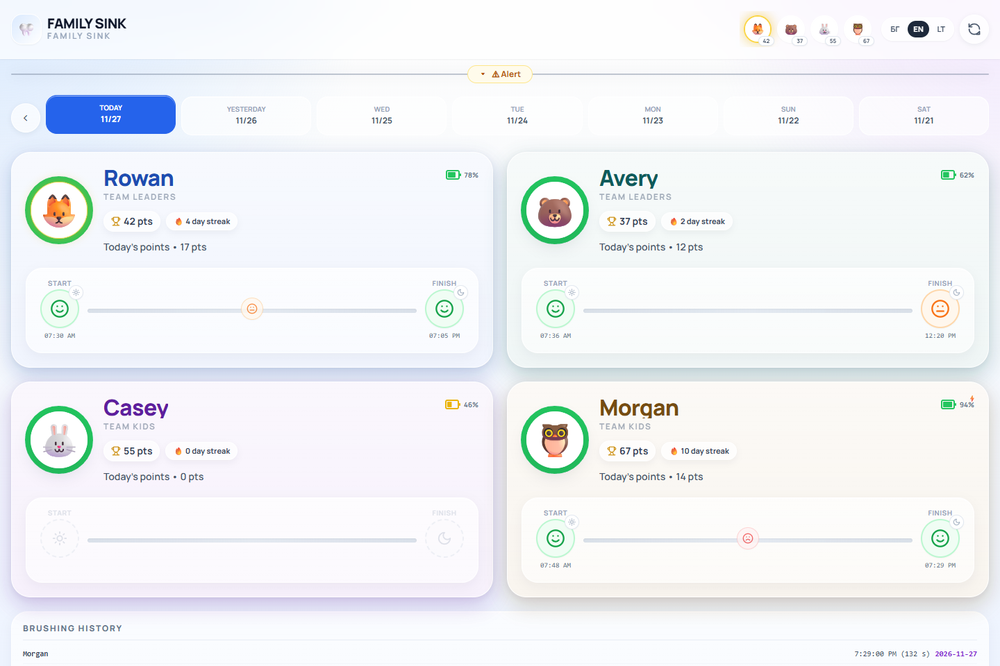

## Our Story

Family Sink started in late 2025 as a project for our own family. We wanted to make an everyday routine a little more fun and help each other build healthy habits. A bit of friendly competition turned out to be a good reason to check in on how everyone was doing.

The first version was a pair of Home Assistant automations and a custom dashboard. We kept using it at home, refining the game and the dashboard as we went. Eventually it became an integration that another household could install, set up with their own brushes, and make their own. That's why we decided to share it with the Home Assistant community.

## The family game

- **See each brush as it happens.** The live badge and progress ring follow the brushing timer. Battery and charging status appear when Home Assistant has those readings.
- **Build a streak.** Brushes earn points based on duration. A brush of at least 120 seconds keeps the default streak going. Finished days contribute morning, evening or missed-day penalties where applicable.
- **Earn a Golden Card.** A Master Brush earns the gold glow for that game day. Consecutive days with Master Brushes can carry the bonus count forward, and reaching three Master Brushes awards the default bonus.
- **See who led the week.** The status strip shows Sink Mood, the daily winner, the scoreboard and the Wall of Fame. Weekly and monthly champions come from the previous completed periods.
- **Make it yours.** Pick a built-in avatar or upload a picture, choose a color and give a participant a team label. The interface is available in **English, Bulgarian and Lithuanian**.

The date strip opens past timelines. Click an intermediate brush marker to reveal its duration. Administrators can adjust scoring and time windows in **Game rules**. The [full game rules](GAME_RULES.md) explain how scores, bonuses and awards are calculated.

| Live brushing | Golden Card and Wall of Fame |
| --- | --- |
| [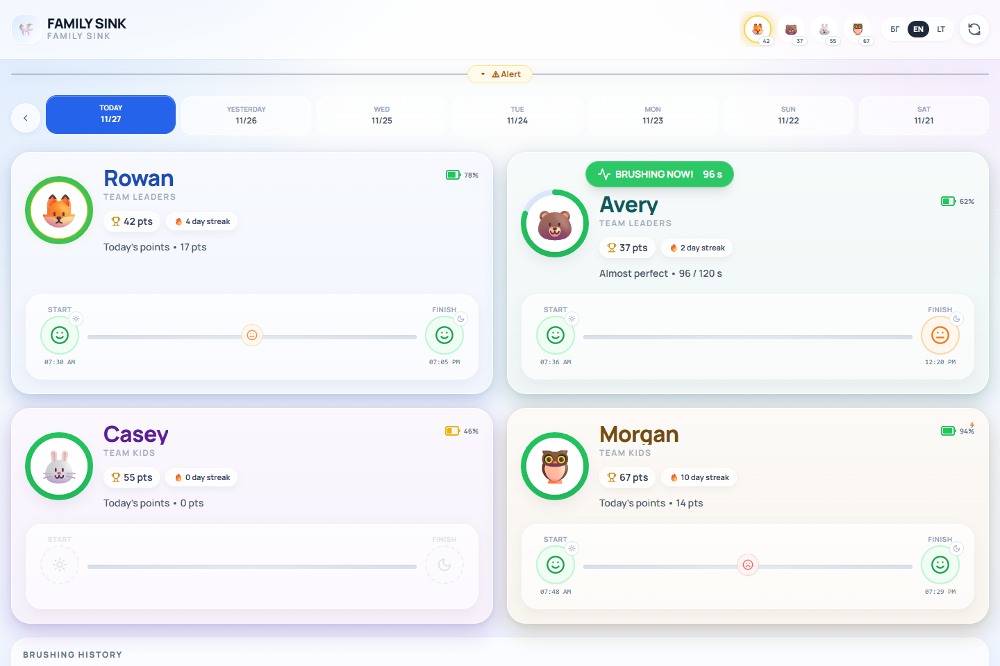](docs/assets/screenshots/live-brushing.png) | [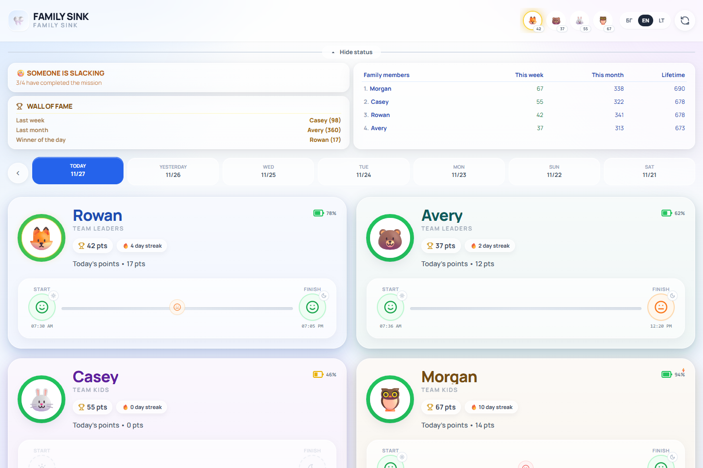](docs/assets/screenshots/achievements.png) |

See Family Sink on mobile and tablet, and watch a live brush

  <a href="docs/assets/screenshots/mobile.png">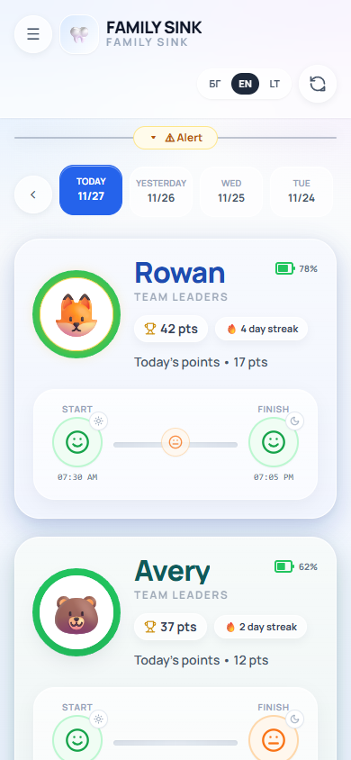</a>
  <a href="docs/assets/screenshots/tablet.png">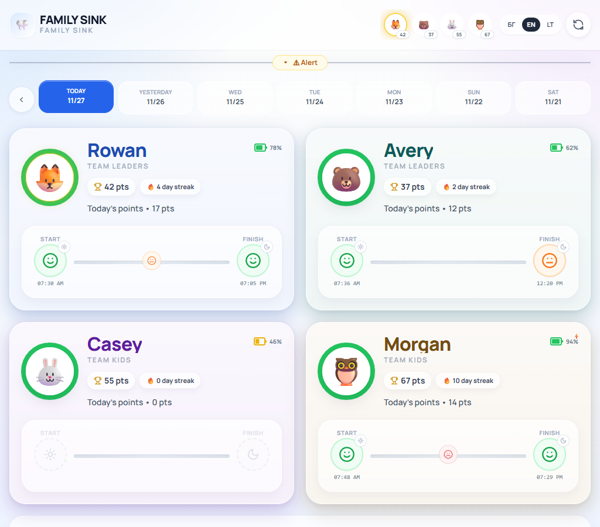</a>

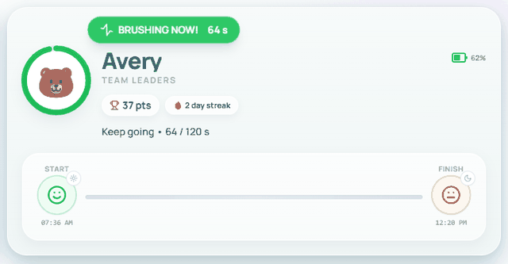

<!-- ha-marketplace:exclude-start -->
## Installation

You'll need **Home Assistant 2026.10.0 or newer**, administrator access for setup, and at least one brush with state and duration entities from the official **Oral-B** integration. Family Sink reads those entities from Home Assistant. Home Assistant's Oral-B integration handles communication with the toothbrush. [Official Oral-B setup and supported devices](https://www.home-assistant.io/integrations/oralb/)

### Manual installation

1. Download the Family Sink ZIP from the [repository's Releases page](https://github.com/boretestprojects/family-sink/releases) or use the ZIP supplied for your installation.
2. Extract its `family_sink` folder into your Home Assistant configuration's `custom_components` directory. On Home Assistant OS the resulting manifest path is `/config/custom_components/family_sink/manifest.json`.
3. Restart Home Assistant. Open **Settings → Devices & services → Add integration**, search for **Family Sink**, and complete setup.
4. Open **Family Sink** in the sidebar or go to `/family-sink` on your Home Assistant server.

### Custom repository installation

When the GitHub repository is public, add `boretestprojects/family-sink` as a custom repository. On **Home Assistant 2026.11 and later** use **Settings → Marketplace → Add from link**. On **2026.10 with HACS installed** use **HACS → ⋮ → Custom repositories** and select **Integration**. Install Family Sink from its repository page, then add the integration under **Devices & services**. Family Sink is prepared for custom repository installation. Official catalogue listing is a separate submission. [Marketplace custom repositories](https://www.home-assistant.io/integrations/marketplace/#custom-repositories) · [HACS custom repositories](https://hacs.xyz/docs/faq/custom_repositories/)

[Full installation, upgrade and migration instructions](INSTALLATION.md)
<!-- ha-marketplace:exclude-end -->

## Set up your family

1. Open the gear menu as a Home Assistant administrator and select **Add member**. Set the name, color, built-in avatar and optional team label.
2. Choose a discovered toothbrush and save. Check **Diagnostics** for a working state and duration sensor. **Manual sensor selection** is available for incomplete mappings.
3. Reopen the saved profile to upload a PNG, JPEG or WebP up to 2 MB. Each browser sees the same profile appearance after refresh.
4. When a brush is replaced, change the assignment on the existing profile to keep its records. Assign each brush to one active member.

See participant setup, toothbrush assignment and game settings

| Family settings | Toothbrush assignment |
| --- | --- |
| [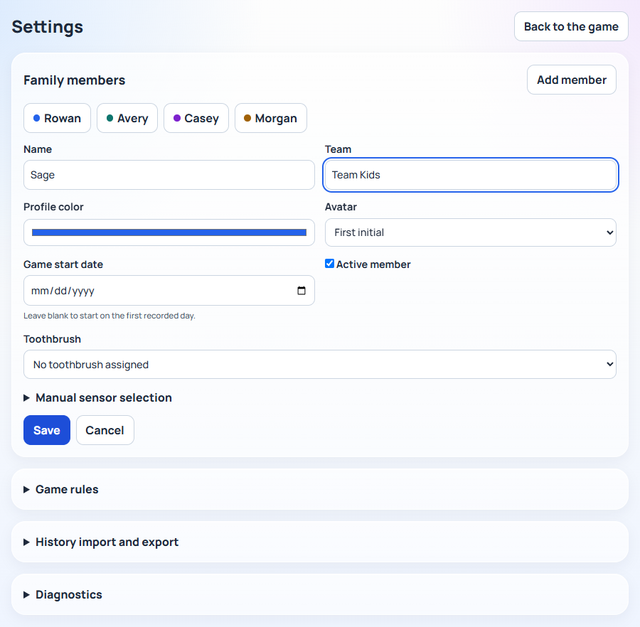](docs/assets/screenshots/family-settings.png) | [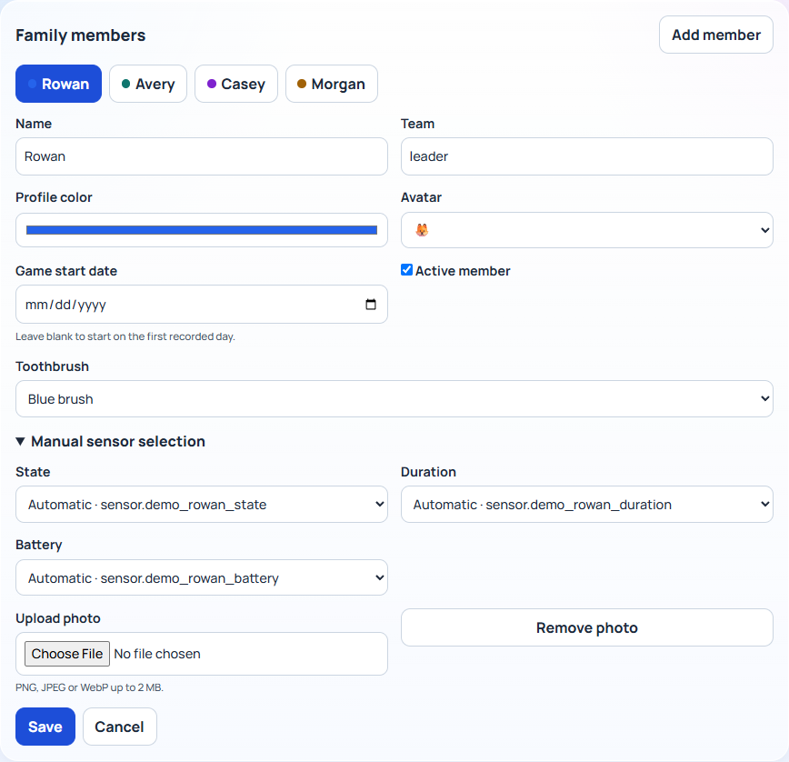](docs/assets/screenshots/toothbrush-assignment.png) |

| Profile appearance | Game settings |
| --- | --- |
| [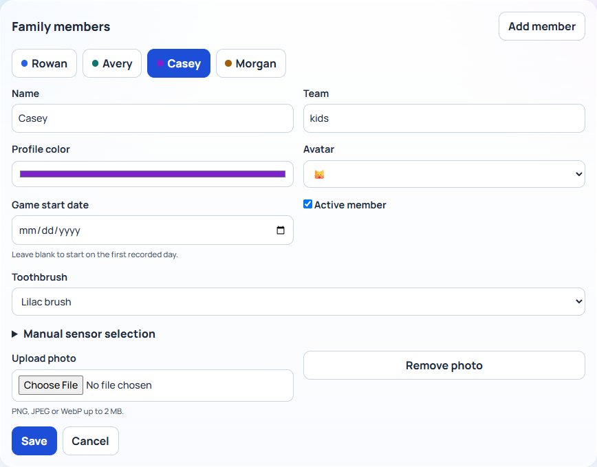](docs/assets/screenshots/profile-appearance.png) | [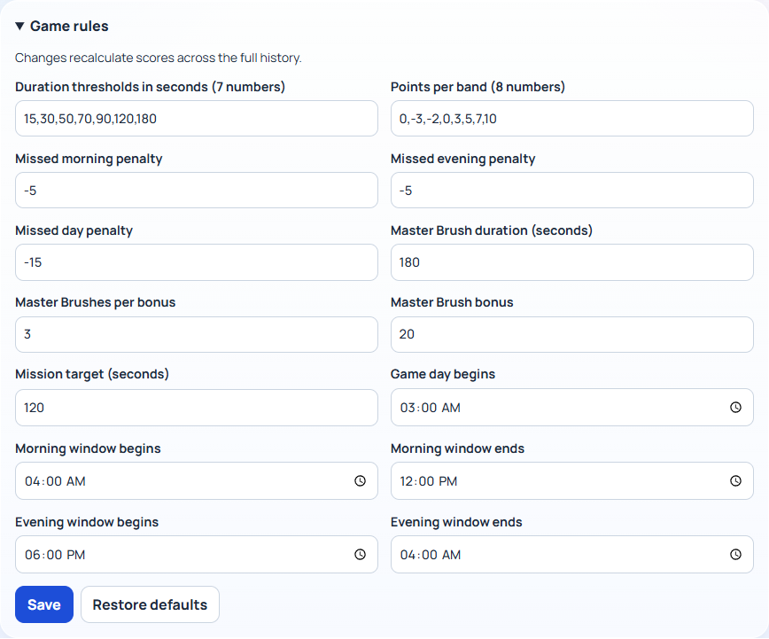](docs/assets/screenshots/game-settings.png) |

## Bring your history

Use **Settings → History import and export** to choose a legacy `brush_log.txt` file, map its user identifiers to Family Sink profiles and import the entries. The same screen exports your history in `timestamp|user|duration` format. The importer skips repeated records and reports invalid or unmatched rows. [Import and export details](INSTALLATION.md#bring-over-the-existing-history)

[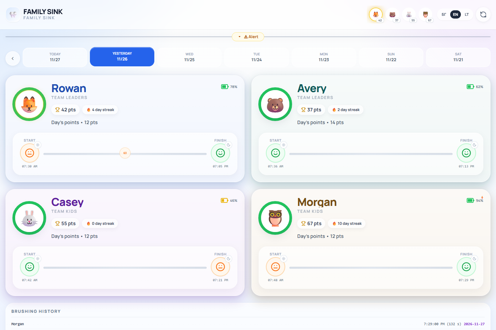](docs/assets/screenshots/history.png)

## Privacy

Family Sink runs on your Home Assistant server. Profiles, uploaded photos, game settings and brushing history live in Home Assistant's local storage. The frontend, fonts and built-in avatars ship with the integration. Authenticated Home Assistant users can view the shared household. Administrative access is required for configuration, uploads and history transfer. Live sensor readings follow Home Assistant's entity permissions. [Data locations and backup details](INSTALLATION.md#local-data-and-access)

The screenshots and animation were captured from the built panel with a fictional family, generated brushing history and simulated Home Assistant sensor data.

## Troubleshooting and contributing

- **A toothbrush is missing.** Look for it in Home Assistant's **Oral-B** integration first, then open Family Sink's **Diagnostics**. [Toothbrush setup and common fixes](INSTALLATION.md#troubleshooting)
- **A session hasn't appeared yet.** Family Sink waits 30 seconds for a potential restart and records sessions of at least 20 seconds. Refresh the panel to check the latest stored sessions. [Recording rules](GAME_RULES.md#recording-and-the-game-day)
- **Found a bug or want to help?** See [Contributing](CONTRIBUTING.md) for setup and the information to include in an issue. Use [GitHub Issues](https://github.com/boretestprojects/family-sink/issues) for public reports and the [security policy](SECURITY.md) for private security reports.

Family Sink is developed by **Padezhki Lab** and distributed under the [MIT license](LICENSE). See the [changelog](CHANGELOG.md) for release history.
